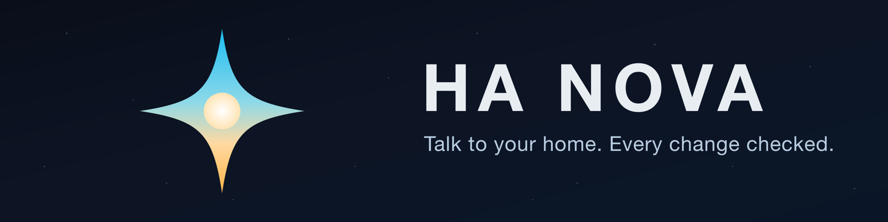
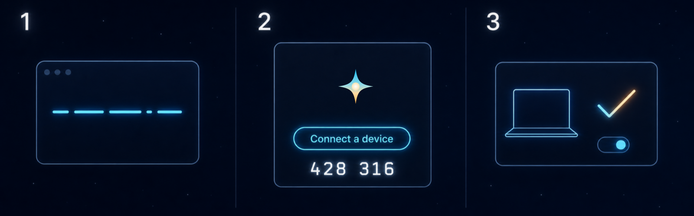
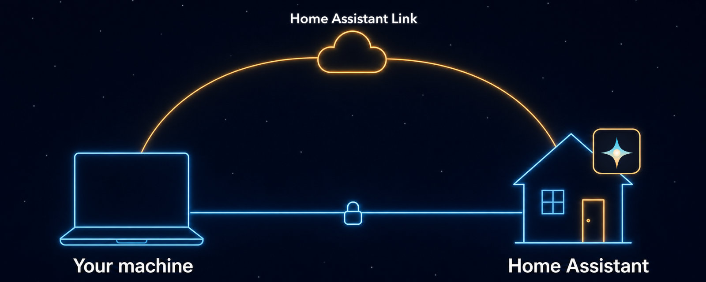
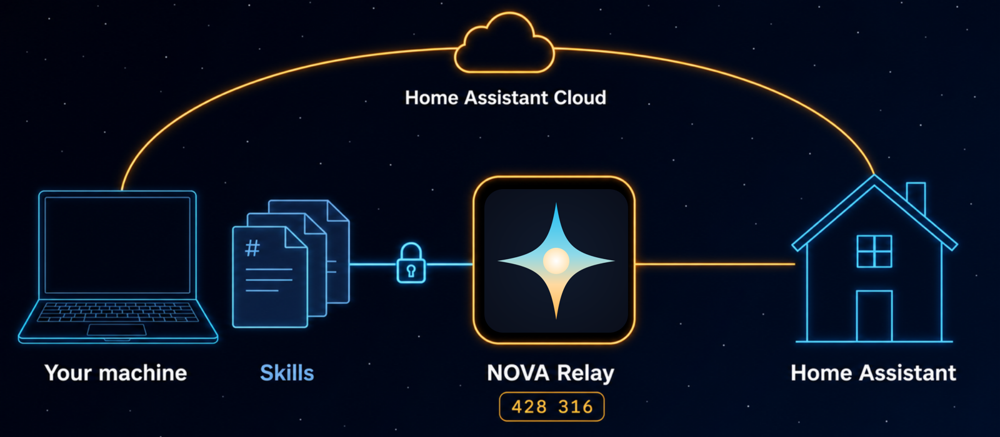
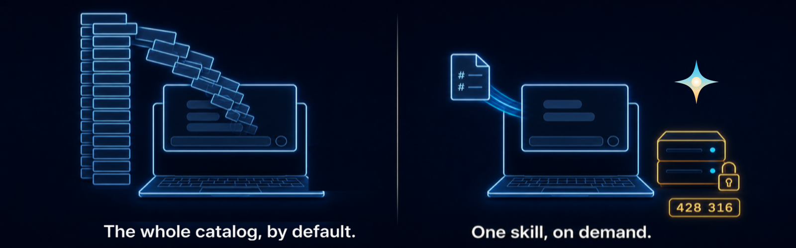

<p align="center">
  
</p>

<p align="center">
  <a href="https://github.com/markusleben/ha-nova/actions/workflows/ci.yml"></a>
  <a href="https://github.com/markusleben/ha-nova/blob/main/LICENSE"></a>
  
</p>

<p align="center">
  <b><a href="https://hanova.app/">hanova.app</a></b> · the 5-minute tour · <b><a href="https://hanova.app/demo/">the demo house</a></b> · look around before you connect your own
</p>

<h2 align="center">Talk to your home. Every change checked.</h2>

<p align="center">
  Connect your AI to Home Assistant. Simple things run right away. Other changes show a preview. Locks, alarms, and deletes wait for you to confirm.<br>
  You confirm with a click in a window on your computer, or a tap on your linked phone.<br>
  <sub>No screen and no phone? Then you type a one-time code.</sub>
</p>

<p align="center">
  Works with <b>Claude Code</b> · <b>Claude Desktop</b> · <b>Codex CLI</b> · <b>OpenCode</b> · <b>Google Antigravity</b> · <b>Hermes Agent</b> (preview)<br>
  and in <b>Claude</b> (also on your phone) and <b>ChatGPT</b> on the web, with the NOVA Relay App
</p>

> *"When I get home, set my main lights to a warm welcome scene"*: you say one sentence and get a checked automation, plus ideas you might not have thought of.

## ✦ Three steps to connect

1. **Run the installer.** Copy one command. Setup opens a page in your browser and finds your Home Assistant and your AI apps.
2. **Sign in with Home Assistant.** Sign in as the owner: the first account made when Home Assistant was set up. If needed, setup installs and starts the NOVA Relay App for you. Then this computer connects by itself.
3. **Choose your safety net, then look around.** The confirmation window on this computer is on. To add your phone, click **Use this phone** (or pick it from the list). On a re-run, **Use another phone** moves it to a new phone once the old phone OKs it. The Claude Code rules are on unless you turn them off: they let Claude Code read HA NOVA's files and make changes you already approved, without asking again. You still confirm every unlock or delete. Then you see your home at a glance: things worth a look (like a low battery or devices without a room) and an automation made for your home, to preview and save. Nothing in your home changes unless you save it.

Signed in, but not as the owner? The page asks the owner to sign in here, or to make a six-digit code for you ([details](#-get-started)). Over SSH or with `--no-browser`, setup asks in the terminal instead. No browser here? Then setup shows the NOVA Relay App page (click "Add", then Install and Start; skipped when the App already runs). You pair with a one-time code: the Home Assistant owner clicks **"Connect a device"** on the NOVA page in the sidebar, and you type the six-digit code. Over SSH, this works well on Linux only. On Windows and macOS, run setup in a terminal on that computer's own screen: over SSH, HA NOVA usually can't save its key.

<p align="center">
  
</p>

*The sign-in and the code work once and run out after a few minutes. Each device gets its own connection, and you can cut it off anytime on the NOVA page.*

<p align="center">
  <b><a href="#-what-you-can-do">What it does</a></b> · <b><a href="#%EF%B8%8F-safe-by-design">Is it safe?</a></b> · <b><a href="#-get-started">Get started</a></b> · <b><a href="#use-ha-nova-in-claude-and-chatgpt">Claude &amp; ChatGPT</a></b> · <b><a href="#optional-remote-access-with-home-assistant-link-beta">Remote access</a></b> · <b><a href="#%EF%B8%8F-how-it-works">How it works</a></b>
</p>

> **Still young, and growing fast.** The main steps are tested end to end on macOS, Linux, and Windows, and your feedback still shapes the product. Back up your setup before you let AI change anything. Hit a problem? [Open an issue](https://github.com/markusleben/ha-nova/issues).

---

## 💬 What You Can Do

Say what you want. HA NOVA works out the rest.

| You say | What happens |
|:--------|:-------------|
| *"Check my automations for problems"* | Checks them against 40+ rules. Finds conflicts, triggers that never fire, and mistakes that are easy to miss |
| *"Why didn't my motion light trigger last night?"* | Replays what really happened and tells you where it stopped and why |
| *"Turn on the porch light at sunset and off at 11 PM"* | Builds the automation, shows it to you, and checks it before anything is saved |
| *"What happened to my living room temperature overnight?"* | Reads the history and sums it up in plain words |
| *"Build a dashboard for the living room"* | Builds whole dashboards and views, also with custom cards you installed. It lists every view and card that changes and saves a copy first. "Undo that" brings the old one back |
| *"Move all kitchen devices to the Kitchen area"* | Moves the devices and entities and shows what will change first |
| *"Turn off the kitchen light"* | Turns it off right away and checks that it really is off. Whole rooms, scenes, and riskier actions show a preview first |
| *"Unlock the front door"* | Shows what will happen, then waits for you: Confirm in a window on your computer, a tap on your linked phone, or a one-time code |
| *"What do I have, and where is this sensor used?"* | Counts rooms, devices, automations, and integrations itself. Lists the automations, scripts, scenes, groups, helpers, and dashboard cards that use a sensor, and says what it couldn't check. Exact numbers, never a guess |
| *"My door sensor died, I paired a new one"* | Moves automations, scripts, scenes, dashboards, helpers, and energy sources to the new device in one plan you check first |
| *"Turn this Node-RED flow into an automation"* | Lists what the rule does, matches each device to a real entity, and builds a Home Assistant automation. The old rule is turned off, not deleted |
| *"Check my ESPHome config for the garage sensor"* | Explains the device file in plain words. Flags removed settings, pins that can't do what the file asks, and passwords written in the file |
| *"Remind me in 20 minutes to check the oven"* | Makes a one-time reminder that turns itself off after it runs |
| *"Show me all temperature sensors"* | Finds entities by name, room, area, or label |
| *"What's the average temperature upstairs?"* | Works out averages and totals across rooms in one step. Names the sensors it used and any it couldn't read |

> Automations and scripts get the full treatment today: a preview, a review, and a check against 40+ rules. Helpers get a preview and a check afterwards. Dashboards get a preview of every changed view and card, a copy before each save, and undo. Device control runs clear everyday actions right away and checks them afterwards. Everything else shows a preview first, and locks, gates, the alarm, and deletes need your OK. Deeper checks come with every release.

---

## 🛡️ Safe by Design

We built this because we didn't trust AI with our own setup either.

**What happens when AI wants to change something:**

1. **Looks first.** Finds your devices, checks your setup, and finds the right names. No guessing.
2. **Shows you the change.** A clear before-and-after table of what will change, in plain words with names, before anything is saved. The one exception: only clear everyday actions run right away, like "turn off the kitchen light". HA NOVA checks them afterwards. The HA NOVA program decides which actions count, never the AI. And it sends nothing if anything changed since a preview.
3. **You approve it.** Unlocking a door, opening a gate or garage door, turning off the alarm, restarting Home Assistant, and deletes need a real confirmation, not just "yes" in the chat. Before a restart, HA NOVA checks your config first. If something is wrong, it says what before you confirm.
   - **On your computer**, a window opens where it can. Click Confirm (OK on Windows) or Cancel. Your AI never sees a code.
   - **With a linked phone**, the phone asks at the same time. The first answer counts, and the phone shows the result. On a computer without a screen (for example a Linux server), the one phone you linked asks. This needs the Home Assistant Companion app. It doesn't work with a standalone relay that runs on your own token.
   - **About the phone:** you can answer on the phone or its Apple Watch without unlocking it. So whoever holds your phone can answer while a request is open (up to 90 seconds), but only for that one action. To link, move, or turn off phone confirmation, you need the unlocked phone. You can also move it to a new phone on the setup page. Once a phone is linked, an action it can't reach is refused. It is never moved to the chat.
   - **With neither**, you get a four-digit one-time code, in the chat or in your AI app's own form where it shows one. But the AI can see it too, so it only counts when you type it yourself.
   - **Deletes:** automation, script, and dashboard deletes use the same window or phone. Other deletes (helpers, scenes, areas, and the like) take a four-digit code in the chat. Each automation or script delete is confirmed on its own. Other batch deletes you checked take one confirmation for the exact list of items.
   - **Screen control:** anything you let control your screen can click that window too. That means computer use, apps you gave Accessibility access, and on Windows and some Linux desktops, other programs. To turn the window off, run `ha-nova setup confirm-window off`.
4. **Saves a copy first.** Before a covered delete or a full replacement of a config, HA NOVA saves a copy of that item. So "gone" has a way back.
5. **Saves and checks.** Reads the config back to make sure the change stuck.
6. **Checks its own work.** Looks for mistakes, conflicts, and things that could fail.
7. **Offers a safe test.** After you save a new or changed automation or script, you get a test plan that fits the risk. It can be a check that changes nothing, or a real run that names every device that will switch before you say go.
8. **Offers a way back, in three steps.**
   - Reply `revert` to undo the latest checked update.
   - Bring back a deleted automation, script, scene, dashboard, or storage helper from its saved copy (a config snapshot), with the same preview and confirmation. "Undo that" right after a delete works, and so does "restore the kitchen automation you deleted yesterday".
   - For everything else, use a Home Assistant backup.

   `revert` and saved copies cover only changes made **through HA NOVA**. HA NOVA can't undo changes made in the Home Assistant UI, by other tools, or by hand in YAML. A saved copy brings back the item itself, not every place that used it. Home Assistant backups cover the whole system.

**The ground rules, always:**

- 🔒 **The Relay's login stays out of the AI.** The App's Home Assistant login stays inside the Relay. Optional Cloud access uses a separate Home Assistant OAuth authorization in this computer's native credential store. The AI sees neither of them.
- 🙈 **Stored codes stay hidden from the AI.** A lock or alarm code saved in its settings, the backup password, and the Thread network key reach the AI only as "hidden", also in HA NOVA's saved copies. Codes written into automations are not hidden.
- 🔑 **Each device is paired on its own.** The Home Assistant sign-in and the six-digit code work once and run out fast. They create a separate login for each device, over an encrypted, pinned connection (OPAQUE, RFC 9807 + SPKI-pinned TLS 1.3 under the hood). This is for App installs. The standalone container uses one shared token instead.
- 🗑️ **Cut off a device with one click (App installs).** Lost a laptop? Retired a computer? Choose "Revoke this device" for it on the NOVA page. Everything else keeps working.
- 📖 **Every rule the AI follows is a Markdown file you can read.**
- 🏠 **HA NOVA runs no cloud relay, and the program sends no usage data or install counts.** Local mode stays between your computer and Home Assistant. Optional Cloud mode uses your Nabu Casa service, and HA NOVA gets none of that traffic.

---

## 🚀 Get Started

One command. One setup page. One sign-in. It even finds your Home Assistant for you.

> **You need:** Home Assistant, any install type. HA OS and Supervised get the NOVA Relay App, and setup helps you install it. Container and Core run the same relay as a [standalone container](docs/reference/relay-container.md): same skills, same safety. It works with a token instead, so skip the steps below and follow that guide from start to end.

**macOS / Linux:**

```sh
curl -fsSL https://raw.githubusercontent.com/markusleben/ha-nova/main/install.sh | bash
```

**Windows (PowerShell):**

```powershell
irm https://raw.githubusercontent.com/markusleben/ha-nova/main/install.ps1 | iex
```

The installer selects the latest stable release. Run the command for your system.

**On a desktop**, setup goes on in your browser. The page shows the Home Assistant it found, or asks for its address. It also shows the AI apps on this computer and sets them up for you. On HA OS and Supervised, choose "Sign in and install NOVA" and sign in as the owner. Setup then installs and starts the NOVA Relay App and connects this computer, all with that one sign-in. An old App is updated the same way. If an up-to-date App already runs, there is nothing to do. Then choose how you confirm risky changes, and see your home at a glance.

**Only use Claude or ChatGPT in the browser?** With no AI app on this computer, choose "I use Claude or ChatGPT in the browser" on the setup page. This needs Home Assistant 2026.10 or newer on HA OS or Supervised, and Home Assistant Link with remote access on, or your own HTTPS address (see [Use HA NOVA in Claude and ChatGPT](#use-ha-nova-in-claude-and-chatgpt)). Right after the owner signs in, setup checks the version, HA OS, and that an internet address is set, before it changes anything. If something is missing, the page says what and offers "Set it up, then check again" or "Use HA NOVA on this computer instead". If all is ready, this computer connects, and chat apps come first.

**Not the owner?** The page asks the owner to sign in. If the owner can't come to this computer, they make a six-digit code in NOVA in Home Assistant ("Connect a device"), and you type it in the terminal. Can't sign in on this computer at all? Choose "Use a six-digit code instead". The owner can make it on any device. On the browser-only path there is no code: the owner signs in here.

**In the terminal.** Over SSH or with `ha-nova setup --no-browser`, setup asks in the terminal instead.

- Want to install the App yourself, or no browser sign-in here (for example over SSH)? Setup takes you to the App page and adds the repository for you. Click "Add", then Install and Start.
- After that, or when the App already runs, setup opens your Home Assistant login. Sign in as the owner, and this computer connects by itself.
- Signed in as another Home Assistant user, over SSH on Linux, or the sign-in didn't work? Then setup asks for a code. The owner opens **NOVA** in the sidebar (or "Open Web UI" on the App page) and clicks **"Connect a device"**. You type the six-digit code.
- On Windows and macOS, run setup in a terminal on the computer's own screen, not over SSH.

After pairing, setup offers to link your phone for confirmations: tap "Allow" on it. The phone must be signed in to the Home Assistant app as an administrator. Setup ends with a first look at your home.

> **Want to look first?** The [demo house](https://hanova.app/demo/) is a pretend Home Assistant with no real devices. Look around before you connect your own. `ha-nova try` connects your AI app to it (the setup page offers it when it finds no Home Assistant), and `ha-nova try --stop` removes it. Everyone shares one login, and it resets every hour. So never enter real names, passwords, or tokens there.

### Use HA NOVA in Claude and ChatGPT

With chat apps on, you can ask about your home and change it from Claude (web, desktop, and phone apps) or ChatGPT (web). No computer needs to run.

**Turn them on** in setup's "You stay in control" step (**Turn on…**), on a re-run with the chat-app switch, or later on the NOVA page in the Home Assistant sidebar (Chat apps). Home Assistant restarts once. Then choose "Add to Claude", or paste the address setup shows into ChatGPT. Sign in to Home Assistant as the owner.

**You need:**

- Home Assistant 2026.10 or newer on HA OS or Supervised, with an up-to-date NOVA Relay App.
- An address Claude and ChatGPT can reach over the internet: Home Assistant Link with remote access on, or your own public HTTPS address with a valid certificate, set as Home Assistant's external URL.
- Self-signed certificates, plain `http://`, Tailscale, and local addresses don't work, and setup can't check the certificate for you. Without a Link or HTTPS address, setup says so and shows no switch. On the browser path, setup checks the version, HA OS, and that an address is set right after the owner signs in.
- Only the Home Assistant owner can turn chat apps on and use them.

**What needs your OK:** the same rules as on a computer. Everyday actions run right away and are checked afterwards. Unlocks and deletes wait for a tap on your linked phone. Without a phone, you type a code in the chat. The AI can see that code too, so it protects less than your phone. On the NOVA page, you can require the phone, or let chat apps only read.

**In Claude, tools have plain names, and you can let read-only steps run without asking.** In Claude, open Settings → Connectors → HA NOVA. Set the read-only tools and "Control a device" to "Always allow". Leave "Run a confirmed change" on "Needs approval", so Claude still asks before a bigger change. Claude may ask again after an update. Details: [Stop Claude from asking before every step](docs/reference/chat-apps.md#stop-claude-from-asking-before-every-step).

**Good to know:**

- Access belongs to your Home Assistant account, not to a device. Anyone who can use your Claude or ChatGPT account can reach your home through it.
- Claude or ChatGPT then holds a Home Assistant sign-in for your account. It works for all of Home Assistant, not only HA NOVA. Turning chat apps off cuts HA NOVA there. To sign Claude or ChatGPT out, open your Home Assistant profile (Security, refresh tokens).
- Turn chat apps off before you remove the NOVA Relay App.
- Helpers, dashboards, and files still need HA NOVA on a computer.

Step by step, ChatGPT plans, and what to do if it doesn't connect: [Use HA NOVA in Claude and ChatGPT](docs/reference/chat-apps.md).

### Optional remote access with Home Assistant Link (Beta)

Setup keeps **Local only** as the default we recommend. On the setup page, Link is one switch in "You stay in control". It shows while Link's remote access answers.

Do you have a paid Home Assistant Link plan (formerly Home Assistant Cloud) from Nabu Casa, with remote access on? Then choose **Local + Home Assistant Link** for automatic remote fallback, or **Home Assistant Link only** to go remote first. In Home Assistant, the service is under **Settings > Home Assistant Cloud** until the new name reaches your Home Assistant. Setup checks your Link address, opens the Home Assistant OAuth sign-in, and saves it in the macOS, Windows, or Linux desktop credential store. HA NOVA runs no additional public tunnel or hosted broker.

Remote access through Link needs Home Assistant OS or Supervised, and a supported desktop to sign in. Did a setup that was already checked get cut off? You can finish over SSH with `ha-nova cloud add --remote-resume`. Headless, WSL, service, gateway, Container, and Core setups stay local only. Sign in to Link as the Home Assistant owner, and this computer connects with no code (this needs an up-to-date NOVA Relay App). You can also sign in as a standard Home Assistant user. Remote-first pairing then uses a separate, private Owner session to create the one-time NOVA device code.

Already installed locally? Run `ha-nova cloud add`, or run `ha-nova setup` again for the same choice.

<p align="center">
  
</p>

*Local stays first: the CLI uses the direct connection and falls back to your Home Assistant Link remote access only when it has to. No switching addresses by hand.*

Once setup is done, try: *"Show me all my automations."*

> **More than one Home Assistant?** Add each one with `ha-nova pair --server <name> --relay-url http://<ha-host>:8791`. Each server gets its own profile and its own login. To pick one, add `--server <name>` to a command. This works in every shell, PowerShell too. Manage them with `ha-nova server list|default|rename|remove`. (The `HA_NOVA_SERVER` environment variable still works too.)

> **Upgrading from an earlier HA NOVA?** Everything keeps working through the update. Still on the old shared access? Pair each computer again once with `ha-nova pair`, then choose "Revoke legacy access" on the NOVA page.

<details>
<summary><strong>Platform notes</strong></summary>

<br>

**macOS**: tested end to end on real Macs.

**Linux**: tested end to end, also without a desktop (servers, containers, LXC, SSH). With no desktop keyring, the device login is saved in a private file instead. A standalone relay (relay token, no device pairing) on such a machine uses `ha-nova setup --service <client>` (Codex CLI, OpenCode, Hermes Agent).

**Windows**: tested end to end on a real Windows 11 PC. Only x64 builds. On Windows 11 on ARM, install from the x64 PowerShell (the installer shows the steps).
- Claude Code is the most tested AI app on Windows today
- Google Antigravity has basic testing
- Codex and OpenCode are still early
- What you need first: Claude Code needs Git for Windows / Git Bash; Google Antigravity Desktop or CLI must be installed
- See [.claude/INSTALL.md](.claude/INSTALL.md) and [.antigravity/INSTALL.md](.antigravity/INSTALL.md)

> Don't download the `ha-nova-installer-bundle-*.tar.gz` / `.zip` files yourself. The installer uses them in the background. Always use the one-line command or `ha-nova update`.

</details>

<details>
<summary><strong>CLI commands & legacy uninstall</strong></summary>

<br>

| Command | What it does |
|:--------|:-------------|
| `ha-nova check-update` | Check for a newer version |
| `ha-nova update` | Update to the latest release |
| `ha-nova setup` | Opens the setup page: what is set up, and your switches. `--no-browser` keeps it in the terminal |
| `ha-nova try` | Connect your AI app to the shared demo house; `--stop` removes it |
| `ha-nova chat-apps on` | Turn on HA NOVA in Claude and ChatGPT (owner sign-in; Home Assistant restarts once). `status` shows the address, `off` turns them off |
| `ha-nova pair` | Pair this computer again with a new six-digit code |
| `ha-nova doctor` | Find connection and setup problems |
| `ha-nova setup confirm-window off` | Turn the confirmation window off (you confirm that in the window). `on` turns it back on |
| `ha-nova setup confirm-phone` | Link one phone for confirmations (pick it, then tap "Allow" on it; picking another phone moves it, once the old phone OKs it). `off` unlinks it, and you confirm that on the phone |
| `ha-nova uninstall` | Asks one question: remove HA NOVA from this computer (skills, settings, and its pairing), remove it but keep the pairing for a reinstall, or cancel. On the last computer that uses the NOVA Relay App, it can remove the App too, after the owner signs in (this needs an up-to-date NOVA Relay App). `--yes` keeps the pairing |
| `ha-nova uninstall --purge` | Remove the program, settings, and saved logins. A few tiny local marker files stay, so an old process can't bring the install back |

**Coming from an old install, from before the Go version?**
- macOS / Linux: `curl -fsSL https://raw.githubusercontent.com/markusleben/ha-nova/main/scripts/legacy-uninstall.sh | bash`
- Windows: `irm https://raw.githubusercontent.com/markusleben/ha-nova/main/scripts/legacy-uninstall.ps1 | iex`

</details>

> **Not a terminal person?** Setup is one command to copy and paste, then a page in your browser. After that, Claude Desktop and Google Antigravity Desktop give you the same skills in an app window. Pairing another computer is one more sign-in (or one six-digit code). Or skip the computer: with chat apps on, ask from Claude or ChatGPT.

---

## ⚙️ How It Works

<p align="center">
  
</p>

**Skills** live on your computer as plain Markdown files. They are the AI's playbook: what to check, what to show you first, and what to check after a change. You can open them, read them, and even edit them.

**The Relay** lives on your Home Assistant server. On the local path, it is the only part that talks to Home Assistant directly, and its Home Assistant login stays inside it. Optional Cloud mode lets the CLI connect through Nabu Casa, with an OAuth sign-in kept in your desktop's secure storage. Neither login ever goes into a prompt. Each paired device still reaches the Relay with its own encrypted login. The NOVA page is where you connect or remove devices.

Most new HA NOVA features are skill updates: text files on your computer. The Relay only changes when a feature needs something really new from Home Assistant. Even then, it stays a simple pipe. All the know-how stays in the skills.

Because the Relay sits right next to Home Assistant, it can do things a remote program can't. For example, it saves a copy of an automation before it updates it, so one word undoes the latest checked update. Deletes of covered items (automations, scripts, scenes, dashboards, and most helpers) save a copy first, so you can bring them back with the same preview and confirmation. Where no copy exists, a Home Assistant backup is the way back.

Every safety promise above is backed by a file and a test. The **[safety page](docs/reference/safety.md)** shows what enforces and checks each one.

---

## ⚖️ Why skills first, not a tool server?

Fair question. We built a tool-based MCP server first: 88,000 lines, never shipped. It taught us what HA NOVA now does differently:

<p align="center">
  
</p>

| | Tool-based MCP server | ✦ HA NOVA |
|:--|:--|:--|
| 📖 **Where the know-how lives** | In server code: to change how it acts, you change the server | In Markdown files you can open, read, and edit yourself |
| 🛡️ **Safety model** | Up to you: read-only modes, switches per tool, approval rules you set up | Built in for every change: a preview first (only clear everyday actions run right away). Locks, gates, the alarm, and deletes wait for a Confirm in a window or on your phone, or a one-time code. Every change is checked afterwards, and each promise is backed by a test |
| 🏠 **Where it runs** | The leading project's recommended setup runs inside Home Assistant's own process | A simple relay in its own process: if it crashes, Home Assistant keeps running. It holds no Home Assistant logic *(chat apps add a small forwarding integration inside Home Assistant)* |
| 🔑 **Connecting a device** | A shared secret (URL or token), or OAuth where set up | Home Assistant sign-in or a one-time six-digit code per device. You can remove each one on the NOVA page *(App installs; the standalone container keeps a token on the server; chat apps use a Home Assistant sign-in held by your Claude or ChatGPT account, removed in your Home Assistant profile)* |

> **The honest bit:** the MCP side is ahead on breadth today: more tools (App management, dashboard screenshots, ZHA inspection), more contributors, more stars. It's the older project. But one thing matters more: **our gaps close one Markdown file at a time. Turning a tool server's Python into plain text you can read would mean a rewrite.**

The full comparison, with names and dates, fair both ways: **[comparison page](docs/reference/comparison.md)**.

---

## 🧩 Skills

34 task skills plus the HA NOVA context skill. Each one is a Markdown file you can read and edit.

- ✏️ **Build & change**: automations & scripts, helpers, scenes, dashboards, areas & labels, device control, device replacement, rule migration, YAML-only config, ESPHome configs
- 🔍 **Understand & fix**: config reading, a map of your whole home, 40+ rule checks, finding out why something failed, history & stats, entity search, system health
- 🧰 **Run & maintain**: backups, updates, HACS packages, recorder & statistics repair, energy, MQTT, InfluxDB history, integration setup
- 🏠 **Everyday**: media & speakers, notifications, cameras, voice assistants, to-dos, calendars
- 🛟 **Admin & safety net**: persons, zones & users (owner-guarded), blueprint fallback, onboarding & troubleshooting

<details>
<summary><strong>The full list — all 34 skills</strong></summary>

<br>

| Skill | What it does |
|:------|:-------------|
| ✏️ **write** | Build and change automations, with a full preview and safety checks |
| 📖 **read** | Show your automation and script configs as they really are |
| 🔍 **review** | Check your setup for mistakes, conflicts, and weak spots |
| 🧱 **dashboard** | Build and change dashboards, views, and cards (installed custom cards too), find broken cards, and manage Lovelace resources, with a copy before each save |
| 🎬 **scene** | Create and manage scenes, including "save this room as a scene" |
| 🗂️ **organize** | Manage areas, floors, labels, and entity details like icons, units, and how a value shows |
| 🕒 **history** | Look up history, logbook timelines, and long-term stats |
| 🏠 **health** | Sum up Home Assistant status, repairs, integrations, system health, and noisy entities |
| 📅 **calendar** | Read calendars and events in a time window |
| ✅ **todo** | Manage to-do and shopping-list items, create Local To-do lists |
| 💾 **backup** | Check backups and create them, also as a safety net before risky changes |
| ⬆️ **updates** | See waiting updates, read release notes, and install them with safety checks |
| 📦 **hacs** | Browse, install, pin, update, and remove HACS packages, with previews and a required backup before risky moves |
| ⚡ **energy** | Look at use, solar, battery, and cost per device; manage Energy dashboard sources |
| 🧹 **maintenance** | Repair statistics, clear out recorder history, and clean up dead entities, with strict safety checks |
| 🎛️ **service-call** | Control lights, climate, covers, switches, and media players |
| 🔎 **entity-discovery** | Find entities by name, room, area, or label |
| 🗺️ **home-map** | Your whole home with exact numbers: rooms, devices, automations, integrations, where an entity is used, and the first look after pairing |
| 🔁 **device** | Replace a dead device or a new phone and move everything that used it in one plan you check first; add or retire a device |
| 🚚 **migrate** | Turn Node-RED, Homey, SmartThings, Hubitat, or openHAB rules and old automation YAML into Home Assistant automations |
| 📟 **esphome** | Explain, check, and edit ESPHome device configs; check the device's entities after an install |
| 🧩 **helper** | Create and manage helpers: counters, timers, template sensors, and more |
| 🩺 **diagnose** | Find out why something failed: "why didn't my automation run?" |
| 🎵 **media** | Control media players, browse libraries, group speakers, send spoken announcements |
| 📣 **notify** | Send notifications to your phone, manage persistent notifications |
| 📷 **camera** | Look at the current camera picture, get stream URLs, record |
| 📡 **mqtt** | Listen to MQTT topics, look at discovery, publish with safety checks |
| 🗣️ **assist** | Test what your voice assistant understands, manage pipelines and what it can reach |
| 👥 **admin** | Manage persons, zones, tags, and user accounts, with strict owner guards |
| 🔌 **integration-setup** | Add new integrations and finish sign-in renewals |
| 📝 **yaml-config** | Edit YAML-only config (template, REST, and command-line sensors, packages, themes) with file access you turn on |
| 📊 **external-sources** | Read old history from InfluxDB that Home Assistant already removed |
| 🛡️ **fallback** | Safety net for blueprints and advanced tasks |
| 🚀 **onboarding** | Find and fix setup and connection problems |

</details>

Want to add a new skill? → [CONTRIBUTING.md](CONTRIBUTING.md)

The skills know which NOVA Relay version they need (see `version.json`). If your App is older, they warn you. Update it in Home Assistant under **Settings > Apps > NOVA Relay**.

---

## 🖥️ Supported Clients

| Client | Type |
|:-------|:-----|
| [Claude Code](https://github.com/anthropics/claude-code) | Terminal |
| [Claude Desktop](https://claude.com/download) (Code tab) | Desktop app |
| [Codex CLI](https://github.com/openai/codex) | Terminal |
| [OpenCode](https://github.com/opencode-ai/opencode) | Terminal |
| [Google Antigravity](https://antigravity.google/) | Desktop app / Terminal |
| Hermes Agent (preview) | Terminal |

> **Claude and ChatGPT chat apps** (Claude on the web, desktop, and phone; ChatGPT on the web) connect through the NOVA Relay App, not a computer: see [Use HA NOVA in Claude and ChatGPT](#use-ha-nova-in-claude-and-chatgpt).

> Google Antigravity is the current Google client path. `ha-nova setup gemini` remains a legacy alias for existing Gemini-era installs.

> **Hermes is in preview.** The Linux desktop route (GNOME Keyring) is tested by the maintainer. macOS and Windows-via-WSL2 are experimental, and native Windows isn't supported. Details: [.hermes/INSTALL.md](.hermes/INSTALL.md).

---

## 🔮 What's Next

HA NOVA is young, and that's the point. Here's where it's going:

- **Deeper reviews everywhere**: the full 40+ rule check, for more than automations
- **Community skills**: write a new workflow as a Markdown file and share it with everyone
- **A guided Docker path in setup**: Container and Core setup without the manual steps

> If you've ever wanted to shape how AI works with Home Assistant, now is when your input really changes the product.

---

## 🤝 Contributing

This is the best time to get involved.

- **Write a skill**: add a new workflow in Markdown, no server code needed
- **Test on your setup**: odd cases from real homes make everything better
- **Improve docs**: make HA NOVA clearer for the next person
- **Pick an [open issue](https://github.com/markusleben/ha-nova/issues)**, especially if you want a workflow to get full support

→ [CONTRIBUTING.md](CONTRIBUTING.md)

---

## 📖 The Story

I spent over a year building an 88K-line MCP server for Home Assistant. I kept adding features and never released it. Others shipped theirs while mine sat on my computer.

Then I saw that the design was the problem. Instead of burying Home Assistant know-how in a huge server, I could keep the server small and write the workflows as plain text: easy to read, easy to edit, and much easier to grow with other people.

HA NOVA is what came out of that. **[Here's an early demo](https://youtu.be/ylak867RkzM)** from the MCP days.

---

## 📄 License

[MIT](LICENSE)

## 🙏 Acknowledgments

Safety-rule ideas inspired by [HALMark](https://github.com/nathan-curtis/HALMark) by Nathan Curtis. Automation patterns, helper guidance, and device-control patterns adapted from [homeassistant-ai/skills](https://github.com/homeassistant-ai/skills) by Sergey Kadentsev ([@sergeykad](https://github.com/sergeykad)) and Julien Lapointe ([@julienld](https://github.com/julienld)).
